# ClimaFit — Propuesta de desarrollo TPI 2026

Backend de Aplicaciones · UTN FRC

Este documento reúne las respuestas del cuestionario de propuesta del Trabajo Práctico Integrador, sección por sección. Los diagramas están en `docs/diagramas/` como imagen (`.png`) y como definición editable en Mermaid (`.mmd`). La colección de Postman está en `postman/`.

---

## Sección 01 — Identificación

- **Nombre del proyecto:** ClimaFit — Gestión de clases deportivas al aire libre con reprogramación según el clima
- **Equipo:** [Nombre o número de grupo]
- **Comisión:** [Ej.: 3K1]
- **Integrantes:**
  - [Nombre Apellido] — Legajo [xxxxx]
  - [Nombre Apellido] — Legajo [xxxxx]
  - [Nombre Apellido] — Legajo [xxxxx]
  - [Nombre Apellido] — Legajo [xxxxx]
- **Responsable de contacto:** [Nombre Apellido] — [email institucional]
- **Repositorio principal:** [URL del repositorio]. Es un repositorio único con una carpeta por componente (`climafit-commons`, `api-gateway`, `ms-actividades`, `ms-clases`, `ms-clima`, `ms-notificaciones`), la infraestructura (`infra/`), el `docker-compose.yml`, la colección de Postman y la documentación.

---

## Sección 02 — Descripción breve del proyecto

ClimaFit es un backend para gimnasios, grupos de entrenamiento y profesores que dan clases en espacios públicos al aire libre de Córdoba, como parques y la costanera. Este tipo de actividad es muy común en la ciudad, pero depende de un clima cada vez más imprevisible por el fenómeno de El Niño. Hoy las suspensiones se deciden a último momento y se avisan a mano, uno por uno. El resultado son alumnos que viajan a clases que no se dictan, reprogramaciones desordenadas y clases que se pierden.

La solución permite administrar tipos de actividad, ejercicios (incluidos los ejercicios personalizados de cada profesor), espacios, clases e inscripciones, con acceso según el rol: administrador, profesor o alumno. Su principal aporte es un proceso automático de evaluación climática y reprogramación. Antes de cada clase al aire libre, el sistema consulta el pronóstico para ese lugar y horario y lo compara con los criterios de la actividad: probabilidad e intensidad de lluvia, viento, temperatura mínima y tormentas. No es lo mismo una clase de yoga que una de running. Con eso decide si la clase se mantiene, queda en riesgo (decide el profesor) o se suspende. Si se suspende, busca el primer día de la semana siguiente en el que el profesor esté libre y el pronóstico sea apto, pasa las inscripciones a la nueva fecha y avisa por WhatsApp a cada alumno con el motivo y la nueva fecha.

El resultado concreto es que una clase afectada por el clima se suspende, se reprograma y se comunica sin intervención manual. Cada alumno sabe a tiempo si tiene que ir y cuándo, y el profesor cuenta con el historial de cambios de estado de cada clase.

---

## Sección 03 — Problema y contexto

**Problema actual.** En Córdoba es muy común entrenar en grupo con un profesor en espacios públicos al aire libre: funcional en el Parque Sarmiento, running en la costanera, yoga en plazas. Estas clases dependen directamente del clima. Con el fenómeno de El Niño, las lluvias intensas, las tormentas y las ráfagas de viento son más frecuentes y cambian de un día para otro, así que se suspenden muchas más clases que antes. A eso se suman los días de invierno con temperaturas muy bajas, en los que algunas actividades no conviene dictarlas. Hoy la decisión y el aviso dependen de cada profesor y se resuelven de manera informal: mira el pronóstico por su cuenta, decide a último momento y avisa por mensajes individuales o en un grupo de WhatsApp. La nueva fecha se arregla después, conversando con cada alumno.

**Causas y dificultades principales.**
- **No hay un criterio definido para suspender.** Depende de lo que cada profesor interprete del pronóstico, y no se tiene en cuenta que cada actividad tolera condiciones distintas: una clase de yoga no se puede dar con llovizna, pero una de running sí.
- **La decisión llega tarde.** La suspensión se comunica cuando los alumnos ya salieron o están en el lugar.
- **El aviso es manual y desparejo.** Algunos alumnos no lo ven o lo ven tarde, y no queda registro de quién fue avisado.
- **Reprogramar es difícil.** Hay que encontrar a mano un día en el que el profesor esté libre y el clima acompañe. Muchas veces la clase directamente se pierde.
- **La información está dispersa.** Las inscripciones, los cupos, las rutinas y los ejercicios se manejan en planillas, chats o de memoria.

**A quiénes afecta.**
- **Alumnos:** viajan a clases que no se dan, pierden clases que pagaron y no saben con certeza cuándo se recuperan.
- **Profesores:** pierden tiempo coordinando y pierden ingresos por clases que no se recuperan.
- **Gimnasios o grupos deportivos:** no pueden ver ni controlar qué pasa con las clases de sus profesores, y las cancelaciones sin aviso hacen que los alumnos se vayan.

**Actores que intervienen.**
- **Administrador del gimnasio o grupo:** gestiona actividades y espacios.
- **Profesor:** crea y dicta las clases, arma las rutinas y decide en los casos dudosos.
- **Alumno:** se inscribe, asiste y recibe los avisos.
- **Servicio de pronóstico meteorológico:** fuente externa de información del clima.
- **Servicio de mensajería WhatsApp:** el canal por el que los alumnos ya se comunican con sus profesores.

**Por qué resolverlo con el sistema propuesto.** El problema no es la falta de información: el pronóstico está disponible para cualquiera. El problema es que nadie lo cruza a tiempo con los datos de cada clase (dónde es, a qué hora, qué actividad y quiénes están inscriptos) usando un criterio claro, y que nadie actúa en consecuencia. Ese cruce es un proceso que se repite para cada clase y sigue reglas que se pueden definir de antemano, así que se puede automatizar. Un backend puede reunir la agenda, las inscripciones, los criterios de cada actividad, el pronóstico y el canal de aviso, cosas que hoy están separadas. Con eso puede decidir de forma consistente, proponer una nueva fecha que cumpla todas las condiciones y avisar a todos los afectados con anticipación. Ni el pronóstico ni WhatsApp pueden hacer esto por separado: el valor está en coordinarlos con las reglas propias del dominio.

---

## Sección 04 — Alcance funcional y proceso principal

### 4.1 Funcionalidades

Prioridad: **Alta** = imprescindible para el proceso central. **Media** = completa el MVP.

**F01 — Inicio de sesión y control de acceso**
- Actor: todos los usuarios.
- Comportamiento: el usuario se autentica en Keycloak (OIDC) y el API Gateway valida el JWT y el rol (ADMIN, PROFESOR o ALUMNO) en cada solicitud.
- Resultado observable: se obtiene un token. Sin token la respuesta es 401 y con rol insuficiente es 403.
- Prioridad: Alta.

**F02 — Gestión de tipos de actividad y criterios climáticos**
- Actor: administrador.
- Comportamiento: alta, modificación y baja lógica de tipos de actividad con sus criterios: probabilidad de lluvia a partir de la cual se considera que va a llover, lluvia máxima tolerada (mm por hora), viento máximo y temperatura mínima.
- Resultado observable: el tipo de actividad queda disponible para crear clases.
- Prioridad: Alta.

**F03 — Gestión de espacios**
- Actor: administrador.
- Comportamiento: alta y modificación de espacios con nombre, dirección, coordenadas e indicación de si son al aire libre o techados.
- Resultado observable: el espacio puede asignarse a clases.
- Prioridad: Alta.

**F04 — Gestión de ejercicios**
- Actor: el administrador carga ejercicios base y el profesor sus ejercicios personalizados.
- Comportamiento: alta, modificación y baja lógica de ejercicios con descripción, nivel y tipos de actividad compatibles.
- Resultado observable: catálogo de ejercicios filtrable por actividad.
- Prioridad: Media.

**F05 — Creación de clase con rutina**
- Actor: profesor.
- Comportamiento: crear una clase indicando actividad, espacio, fecha y hora, duración, cupo y rutina de ejercicios.
- Resultado observable: la clase queda en estado PROGRAMADA.
- Prioridad: Alta.

**F06 — Modificación y reprogramación manual de clase**
- Actor: profesor.
- Comportamiento: modificar cupo, duración o rutina de una clase, o cambiar su fecha (incluido reagendar una clase SUSPENDIDA_SIN_FECHA).
- Resultado observable: la clase queda actualizada. Si cambia la fecha, pasa a REPROGRAMADA y se notifica a los inscriptos.
- Prioridad: Alta.

**F07 — Cancelación de clase**
- Actor: profesor o administrador.
- Comportamiento: cancelar una clase sin borrarla.
- Resultado observable: la clase queda CANCELADA, sus inscripciones se cancelan y se notifica a los alumnos.
- Prioridad: Alta.

**F08 — Consulta de clases disponibles**
- Actor: alumno (también profesor y administrador).
- Comportamiento: buscar clases por actividad, espacio, fechas y estado.
- Resultado observable: listado de clases con cupo disponible y estado.
- Prioridad: Alta.

**F09 — Inscripción y cancelación de inscripción**
- Actor: alumno.
- Comportamiento: inscribirse a una clase, consultar sus inscripciones o cancelar una inscripción.
- Resultado observable: la inscripción queda ACTIVA o CANCELADA y se actualiza el cupo.
- Prioridad: Alta.

**F10 — Preferencias de contacto**
- Actor: alumno o profesor.
- Comportamiento: registrar el teléfono y aceptar o rechazar los avisos por WhatsApp.
- Resultado observable: la preferencia queda guardada.
- Prioridad: Alta.

**F11 — Evaluación climática de clases**
- Actor: el sistema (tarea programada cada 3 horas) o el profesor o administrador (evaluación manual).
- Comportamiento: evaluar el pronóstico de cada clase al aire libre contra los criterios de su actividad y aplicar la decisión correspondiente.
- Resultado observable: queda registrada una evaluación APTA, EN_RIESGO, NO_APTA o FALLIDA, con su motivo y los valores del pronóstico.
- Prioridad: Alta.

**F12 — Decisión sobre clase en riesgo**
- Actor: profesor.
- Comportamiento: mantener o suspender una clase que quedó EN_RIESGO.
- Resultado observable: la clase vuelve a su estado anterior o se suspende y entra en la reprogramación.
- Prioridad: Alta.

**F13 — Reprogramación automática**
- Actor: sistema.
- Comportamiento: buscar un nuevo día para una clase suspendida y pasar las inscripciones a la nueva fecha.
- Resultado observable: la clase queda REPROGRAMADA o SUSPENDIDA_SIN_FECHA.
- Prioridad: Alta.

**F14 — Notificación por WhatsApp**
- Actor: sistema.
- Comportamiento: avisar a cada inscripto cuando la clase se suspende, se reprograma o se cancela, y avisar al profesor cuando su clase queda en riesgo.
- Resultado observable: cada notificación queda ENVIADA, OMITIDA o FALLIDA.
- Prioridad: Alta.

**F15 — Historial de estados de la clase**
- Actor: profesor o administrador.
- Comportamiento: consultar los cambios de estado de una clase, con fecha, estado anterior, estado nuevo, motivo y responsable (usuario o SISTEMA).
- Resultado observable: listado cronológico de los cambios de estado.
- Prioridad: Media.

**Fuera del alcance:**
- Interfaz web o móvil. El backend se usa desde la colección de Postman y Swagger.
- Pagos y abonos.
- Control de asistencia.
- Lista de espera.
- Confirmación de asistencia a la clase reprogramada.
- Respuestas del alumno por WhatsApp.
- Notificaciones por email o push.
- Reserva o capacidad de los espacios.
- Gestión de varios gimnasios separados (multi-tenant).
- Mensajería asincrónica con broker.

### 4.2 Reglas de negocio

**RN01 — Cupo máximo**
- Condición: un alumno se inscribe a una clase.
- Comportamiento: la inscripción solo se acepta si los inscriptos activos son menos que el cupo.
- Rechazo: 409 `CUPO_COMPLETO`.
- Funcionalidad: F09.

**RN02 — Clase disponible para inscripción**
- Condición: un alumno se inscribe a una clase o cancela su inscripción.
- Comportamiento: solo puede inscribirse si la clase está PROGRAMADA, EN_RIESGO o REPROGRAMADA y todavía no empezó. Solo puede cancelar antes del inicio. No puede inscribirse dos veces a la misma clase.
- Rechazo: 409 `CLASE_NO_DISPONIBLE` o 409 `YA_INSCRIPTO`.
- Funcionalidad: F09.

**RN03 — Superposición del alumno**
- Condición: un alumno se inscribe a una clase.
- Comportamiento: no puede tener otra inscripción activa en un horario que se superponga.
- Rechazo: 409 `SUPERPOSICION_ALUMNO`.
- Funcionalidad: F09.

**RN04 — Superposición del profesor**
- Condición: se crea, modifica o reprograma una clase.
- Comportamiento: el profesor no puede tener dos clases que se superpongan.
- Rechazo: 409 `SUPERPOSICION_PROFESOR`.
- Funcionalidades: F05, F06, F13.

**RN05 — Autorización sobre la clase**
- Condición: alguien modifica, reprograma o cancela una clase, decide sobre una clase en riesgo, consulta su historial o la evalúa manualmente.
- Comportamiento: solo puede hacerlo el profesor de la clase o un administrador.
- Rechazo: 403 `ACCESO_DENEGADO`.
- Funcionalidades: F06, F07, F11, F12, F15.

**RN06 — Cancelación y clases pasadas**
- Condición: se cancela o modifica una clase.
- Comportamiento: la clase nunca se borra. Al cancelarla pasa a CANCELADA, se cancelan sus inscripciones y se notifica a los alumnos. Una clase cuya hora de inicio ya pasó, o que está CANCELADA, no admite cambios.
- Rechazo: 409 `CLASE_NO_MODIFICABLE`.
- Funcionalidades: F06, F07, F14.

**RN07 — Compatibilidad de ejercicios**
- Condición: el profesor arma o modifica la rutina de una clase.
- Comportamiento: la rutina solo puede incluir ejercicios activos y compatibles con el tipo de actividad de la clase. ms-clases lo verifica consultando a ms-actividades.
- Rechazo: 422 `EJERCICIO_INCOMPATIBLE`.
- Funcionalidades: F05, F06.

**RN08 — Propiedad de los ejercicios**
- Condición: se consulta, modifica o da de baja un ejercicio personalizado.
- Comportamiento: un ejercicio personalizado solo lo ve y lo modifica el profesor que lo creó. Los ejercicios base solo los modifica el administrador. Las bajas son lógicas, así que las rutinas existentes no se ven afectadas.
- Rechazo: 404 si el ejercicio personalizado no es del profesor; 403 si un profesor intenta modificar un ejercicio base.
- Funcionalidad: F04.

**RN09 — Clases a evaluar**
- Condición: se ejecuta la evaluación climática.
- Comportamiento: solo se evalúan clases al aire libre, en estado PROGRAMADA, REPROGRAMADA o EN_RIESGO, que empiezan dentro de las próximas 24 horas. Las clases en espacios techados no se evalúan.
- Rechazo: en la evaluación manual, 409 `CLASE_NO_EVALUABLE` si la clase no cumple estas condiciones.
- Funcionalidad: F11.

**RN10 — Evaluación del pronóstico**
- Condición: se evalúa el pronóstico de las horas que dura la clase.
- Comportamiento: se toman la mayor probabilidad de lluvia, la mayor lluvia en mm por hora, el mayor viento y la menor temperatura de esas horas, y si hay tormenta eléctrica. La lluvia solo cuenta si su probabilidad alcanza la de la actividad (`prob_lluvia_max`); por debajo, se considera que no va a llover.
  - **NO_APTA:** la lluvia cuenta y supera los mm por hora que tolera la actividad (`lluvia_max_mm_hora`), se supera el viento máximo, la temperatura queda por debajo de la mínima o hay tormenta eléctrica.
  - **EN_RIESGO:** ningún límite se supera, pero algún valor queda cerca: la lluvia cuenta y llega al 80 % de los mm tolerados (margen del 20 %; con límite 0 no hay zona de riesgo), el viento queda a 10 km/h o menos del máximo, o la temperatura queda a 2 °C o menos de la mínima.
  - **APTA:** en cualquier otro caso.
- Funcionalidad: F11.

**RN11 — Decisión según el resultado**
- Condición: termina la evaluación de una clase.
- Comportamiento: si el resultado es NO_APTA, la clase se suspende automáticamente y empieza la reprogramación. Si es EN_RIESGO, la clase pasa a ese estado y se envía una alerta por WhatsApp al profesor. Si es APTA, no cambia nada.
- Funcionalidades: F11, F12, F13, F14.

**RN12 — Clase en riesgo**
- Condición: una clase está EN_RIESGO.
- Comportamiento: el profesor decide mantenerla o suspenderla. Si la mantiene, vuelve a su estado anterior. Si no decide, la clase sigue vigente y la próxima evaluación vuelve a analizarla.
- Rechazo: 409 `CLASE_NO_EN_RIESGO` si se decide sobre una clase que no está en riesgo.
- Funcionalidad: F12.

**RN13 — Búsqueda de nuevo día**
- Condición: una clase queda SUSPENDIDA.
- Comportamiento: se prueba el mismo horario en cada uno de los 7 días siguientes. Se elige el primer día en el que el profesor está libre (RN04) y el pronóstico es APTA (RN10). Las inscripciones activas pasan a la nueva fecha. Si no hay ningún día viable, la clase pasa a SUSPENDIDA_SIN_FECHA y el profesor la reagenda manualmente (F06).
- Funcionalidad: F13.

**RN14 — Consentimiento para WhatsApp**
- Condición: se envía una notificación.
- Comportamiento: solo se envía si el destinatario aceptó recibir avisos y tiene teléfono registrado. Si no, la notificación queda OMITIDA.
- Funcionalidades: F10, F14.

**RN15 — Notificación única por evento**
- Condición: se pide enviar una notificación.
- Comportamiento: cada evento tiene un identificador generado por ms-clases y se notifica una sola vez a cada destinatario, aunque el pedido se repita. Lo garantiza una restricción única (evento, usuario).
- Rechazo: los pedidos duplicados se ignoran sin error.
- Funcionalidad: F14.

**RN16 — Falla de servicios**
- Condición: un servicio que participa del proceso falla o no responde a tiempo.
- Comportamiento:
  - Si fallan ms-clima, Open-Meteo o ms-actividades durante la evaluación, la clase no cambia de estado, la evaluación queda FALLIDA y se reintenta en la próxima ejecución.
  - Si falla WhatsApp, se reintenta hasta 3 veces con espera creciente y después la notificación queda FALLIDA, sin revertir el cambio de la clase.
  - Si ms-notificaciones no responde, el cambio de estado queda marcado como pendiente de notificar y la tarea programada lo reenvía con el mismo identificador de evento (RN15).
- Funcionalidades: F11, F14.

**Estados y transiciones**

- **Clase:**
  - Se crea en PROGRAMADA.
  - PROGRAMADA o REPROGRAMADA pasan a EN_RIESGO o a SUSPENDIDA según la evaluación (RN11).
  - EN_RIESGO vuelve a su estado anterior si el profesor la mantiene, o pasa a SUSPENDIDA si la suspende (RN12).
  - SUSPENDIDA pasa a REPROGRAMADA si hay día viable, o a SUSPENDIDA_SIN_FECHA si no lo hay (RN13).
  - SUSPENDIDA_SIN_FECHA pasa a REPROGRAMADA cuando el profesor la reagenda.
  - PROGRAMADA pasa a REPROGRAMADA si el profesor cambia la fecha.
  - Cualquier clase que todavía no empezó puede pasar a CANCELADA.
  - Una vez pasada su hora de inicio, la clase ya no admite cambios (RN06).
- **Inscripción:** ACTIVA o CANCELADA.
- **Evaluación climática:** APTA, EN_RIESGO, NO_APTA o FALLIDA.
- **Notificación:** se crea PENDIENTE y pasa a ENVIADA, OMITIDA o FALLIDA.

### 4.3 Proceso principal: evaluación climática y reprogramación de clases al aire libre

**Evento inicial:** una tarea programada en ms-clases que se ejecuta cada 3 horas, o la evaluación manual que pide un profesor o el administrador (F11).

**Participantes:** ms-clases (orquesta el proceso), ms-actividades, ms-clima, ms-notificaciones, el profesor, los alumnos inscriptos y los servicios externos Open-Meteo y Twilio WhatsApp.

**Pasos:**
- **P1.** Se seleccionan las clases al aire libre que empiezan dentro de las próximas 24 horas. Relación: F11, RN09.
- **P2.** ms-clases obtiene de ms-actividades los criterios climáticos de la actividad y las coordenadas del espacio. Relación: F02, F03.
- **P3.** ms-clases le pide a ms-clima que evalúe el pronóstico para ese lugar y las horas de la clase. ms-clima consulta Open-Meteo. Relación: F11, RN10, RN16.
- **P4.** Se decide según el resultado. Si es APTA, la clase se mantiene. Si es EN_RIESGO, la clase pasa a ese estado, se alerta al profesor y él decide. Si es NO_APTA, la clase se suspende. Relación: F11, F12, F14, RN05, RN11, RN12.
- **P5.** La clase pasa a SUSPENDIDA y se busca un nuevo día: el mismo horario en los 7 días siguientes, con el profesor libre y pronóstico APTA. ms-clima evalúa todos los días candidatos en una sola llamada. Relación: F13, RN04, RN13.
- **P6.** Si se encuentra un día, la clase pasa a REPROGRAMADA y las inscripciones pasan a la nueva fecha. Si no, pasa a SUSPENDIDA_SIN_FECHA. Cada cambio queda en el historial. Relación: F13, F15, F06.
- **P7.** ms-clases le pide a ms-notificaciones que avise del evento a cada inscripto. ms-notificaciones registra el evento, responde de inmediato y envía los mensajes por WhatsApp en segundo plano. Relación: F14, RN14, RN15, RN16.
- **P8.** El alumno mantiene su lugar en la nueva fecha o cancela su inscripción. Relación: F09, RN02.

**Excepciones relevantes:**
- Si el clima o el catálogo no responden, la evaluación queda FALLIDA, la clase no cambia y se reintenta (RN16).
- Si no hay día viable, la clase queda SUSPENDIDA_SIN_FECHA y el profesor la reagenda (RN13, F06).
- Si falla WhatsApp, se reintenta y después la notificación queda FALLIDA, sin revertir la suspensión (RN16).
- Si ms-notificaciones no responde, el aviso queda pendiente y se reenvía sin duplicar (RN15, RN16).
- Si el alumno no aceptó WhatsApp, la notificación queda OMITIDA (RN14).

**Resultado final:** la clase queda en un estado coherente con el pronóstico (mantenida, reprogramada, sin fecha o cancelada), los alumnos y el profesor quedan avisados y cada cambio de estado queda registrado en el historial (F15).

**Diagrama de actividades del proceso** (`docs/diagramas/proceso.mmd` → `proceso.png`)

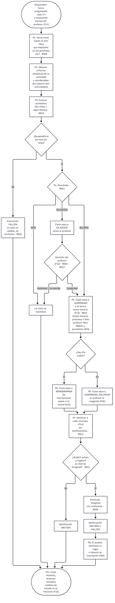

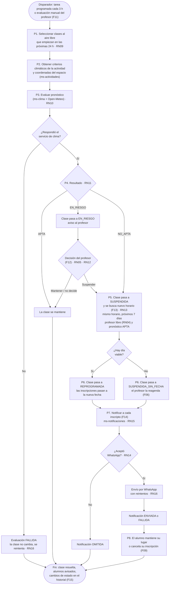

**Diagrama de estados de la clase** (`docs/diagramas/estados.mmd` → `estados.png`)

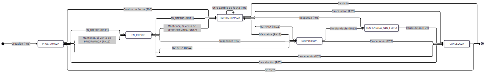

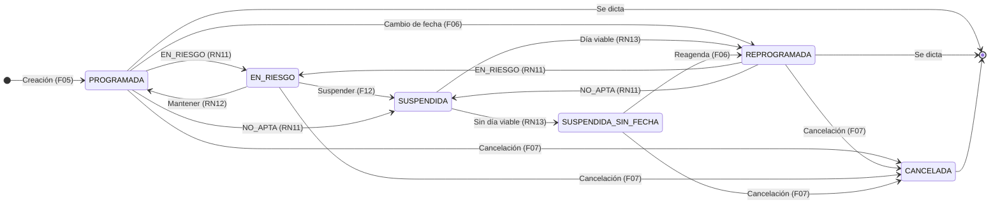

**Explicación.** El diagrama de actividades muestra el proceso de principio a fin. Los rombos son las decisiones y cada paso está rotulado con las funcionalidades y reglas que intervienen. El diagrama de estados muestra el ciclo de vida de la clase, que es la entidad central del proceso, y asocia cada transición con la regla o funcionalidad que la provoca. Cuando una clase EN_RIESGO se mantiene, vuelve a su estado anterior (PROGRAMADA o REPROGRAMADA). En el diagrama esa transición se dibuja hacia PROGRAMADA para simplificarlo.

---

## Sección 05 — Arquitectura: Contexto (C4 · C1)

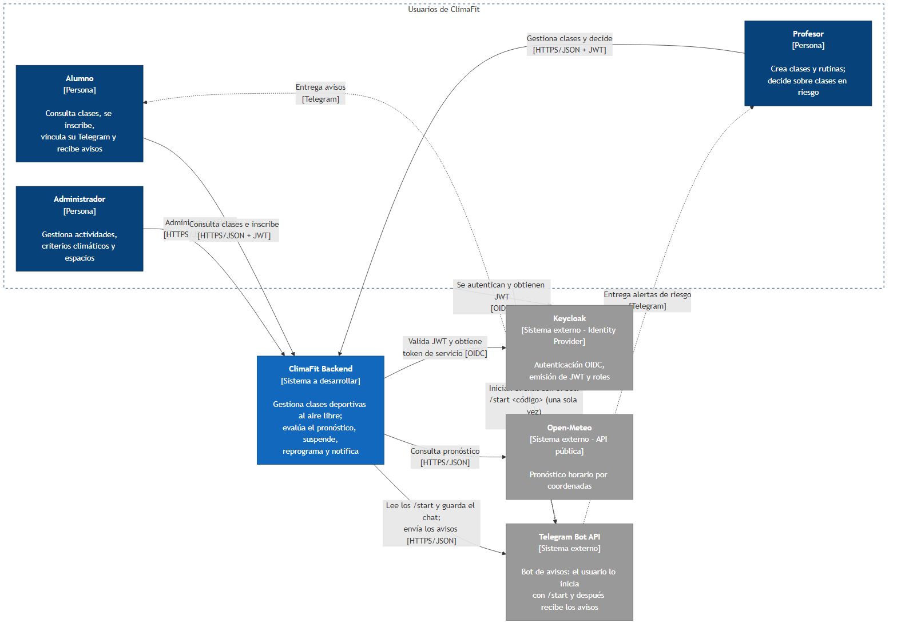

Definición editable (`docs/diagramas/c4-contexto.mmd`, Mermaid con la convención de colores de C4):

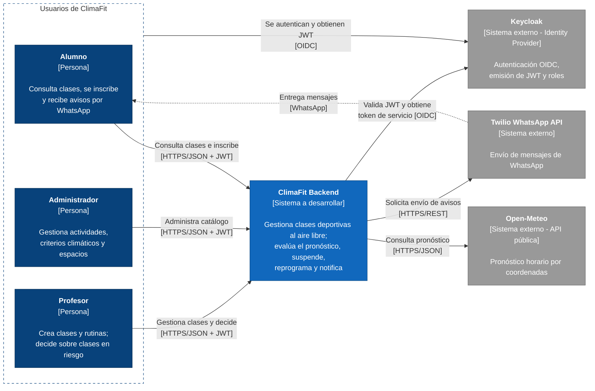

**Elementos**
- **Alumno (persona):** consulta clases, se inscribe o cancela, registra su teléfono y recibe los avisos por WhatsApp.
- **Profesor (persona):** crea y modifica clases y rutinas, crea ejercicios propios, decide sobre clases en riesgo, reagenda clases sin fecha y consulta el historial y las notificaciones de sus clases.
- **Administrador (persona):** gestiona tipos de actividad con sus criterios climáticos, espacios y ejercicios base, y puede ejecutar la evaluación general.
- **ClimaFit Backend (sistema a desarrollar):** gestiona clases al aire libre y ejecuta el proceso de evaluación climática, suspensión, reprogramación y notificación.
- **Keycloak (sistema externo, Identity Provider):** autentica a los usuarios con OIDC, emite JWT con los roles ADMIN, PROFESOR y ALUMNO, y emite el token de servicio que usan los microservicios entre sí. Se despliega en el mismo Docker Compose, pero en el contexto es un sistema que el equipo no desarrolla.
- **Open-Meteo (API pública externa):** pronóstico horario por coordenadas (probabilidad de lluvia, precipitación en mm, viento, temperatura y código de tiempo). Es la información que define si una clase se suspende. No requiere API key.
- **Twilio WhatsApp API (sistema externo):** envía los mensajes de WhatsApp a alumnos y profesores.

**Relaciones**
- Usuarios → Keycloak: se autentican y obtienen un JWT (OIDC).
- Alumno, Profesor y Administrador → ClimaFit: solicitudes REST/JSON con el JWT, según su rol.
- ClimaFit → Keycloak: valida los tokens (claves públicas JWKS) y obtiene un token de servicio con client credentials.
- ClimaFit → Open-Meteo: consulta el pronóstico de las coordenadas del espacio para las horas de la clase y para los días candidatos.
- ClimaFit → Twilio: solicita el envío de cada aviso.
- Twilio → Alumno: entrega el mensaje de WhatsApp.

---

## Sección 06 — Arquitectura: Contenedores (C4 · C2)

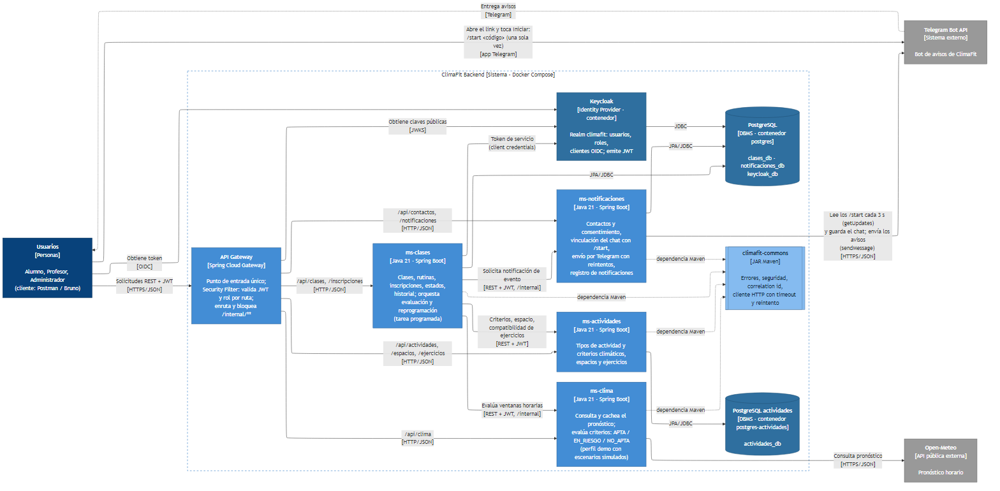

Definición editable (`docs/diagramas/c4-contenedores.mmd`):

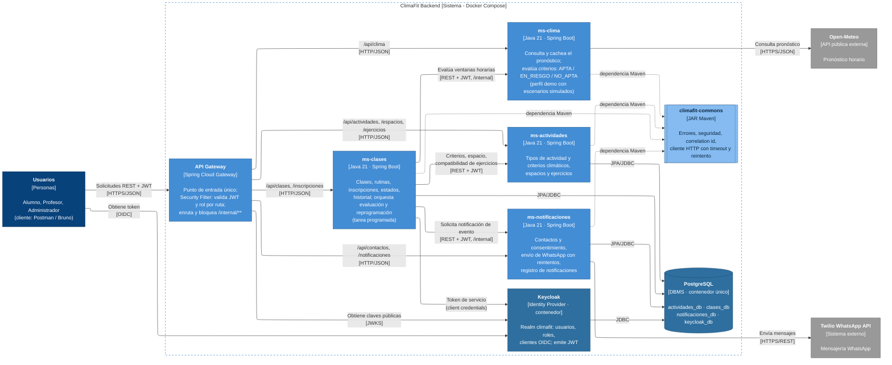

**Contenedores**

**API Gateway** — Spring Cloud Gateway (Java 21, Spring Boot)
- Único punto de entrada; es el único contenedor con puerto publicado además de Keycloak (8080).
- Enruta `/api/**` hacia cada microservicio.
- Su Security Filter valida el JWT contra Keycloak (401 si falta o es inválido) y aplica reglas de rol por ruta y método (403).
- No expone las rutas `/internal/**`.
- Genera el `X-Correlation-Id` y publica el Swagger UI unificado.

**ms-actividades** — Java 21, Spring Boot, Spring Data JPA
- Catálogo del dominio: tipos de actividad con sus criterios climáticos, espacios con coordenadas y ejercicios (base y personalizados).
- Verifica la compatibilidad de ejercicios con una actividad.
- Base: `actividades_db`.

**ms-clases** — Java 21, Spring Boot, Spring Data JPA, `@Scheduled`
- Núcleo del negocio: clases, rutinas, inscripciones, máquina de estados, evaluaciones registradas e historial.
- Orquesta el proceso principal con una tarea programada cada 3 horas y con la evaluación manual.
- Llama a ms-actividades, ms-clima y ms-notificaciones con un token de servicio.
- Base: `clases_db`.

**ms-clima** — Java 21, Spring Boot, Caffeine
- Adapta Open-Meteo al dominio: consulta el pronóstico horario, lo guarda en caché (30 min por coordenada) y evalúa ventanas horarias contra los criterios recibidos (RN10).
- Tiene un modo REAL, SIMULADO y FALLA (perfil `demo`) para demostrar el proceso de forma reproducible.
- No tiene base de datos: el pronóstico se puede volver a consultar y las evaluaciones se guardan en ms-clases.

**ms-notificaciones** — Java 21, Spring Boot, Spring Data JPA, `@Async`
- Contactos y consentimiento.
- Recibe eventos de ms-clases, los registra y responde 202.
- Envía los mensajes por WhatsApp en segundo plano, con reintentos e idempotencia (RN14, RN15, RN16).
- El proveedor es configurable: `twilio`, o `log` para demo, que registra el mensaje sin enviarlo.
- Base: `notificaciones_db`.

**climafit-commons** — JAR Maven
- Librería propia usada por los cuatro microservicios: errores, seguridad, correlation id y cliente HTTP (ver Sección 09).
- No es un contenedor en ejecución: es una dependencia empaquetada dentro de cada servicio.

**PostgreSQL** — PostgreSQL 17, un solo contenedor
- Una base de datos y un usuario por microservicio (`actividades_db`, `clases_db`, `notificaciones_db`) y `keycloak_db` para Keycloak.
- Un servicio no puede acceder a la base de otro.

**Keycloak** — Keycloak 26
- Realm `climafit` importado al arrancar: roles ADMIN, PROFESOR, ALUMNO y SERVICIO, usuarios de prueba, el cliente público `climafit-api` y el cliente confidencial `climafit-servicios` (service account con rol SERVICIO).

**Relaciones y comunicaciones**
- Usuarios → API Gateway: HTTP/JSON con `Authorization: Bearer <JWT>`.
- Usuarios → Keycloak: obtención de token.
- API Gateway → Keycloak: descarga de claves públicas (JWKS) para validar firmas.
- API Gateway → microservicios: enrutamiento HTTP dentro de la red interna de Docker:
  - `/api/actividades`, `/api/espacios` y `/api/ejercicios` → ms-actividades.
  - `/api/clases` y `/api/inscripciones` → ms-clases.
  - `/api/clima` → ms-clima.
  - `/api/contactos` y `/api/notificaciones` → ms-notificaciones.
- ms-clases → ms-actividades: REST sincrónico para obtener criterios y espacio y verificar la compatibilidad de la rutina.
- ms-clases → ms-clima: REST sincrónico `/internal/evaluaciones`, con una o varias ventanas horarias por llamada.
- ms-clases → ms-notificaciones: REST `/internal/notificaciones`; la respuesta es inmediata (202) y el envío es asincrónico.
- ms-clases → Keycloak: token de servicio (client credentials). Todas las llamadas entre servicios usan ese token y los endpoints `/internal/**` exigen el rol SERVICIO.
- ms-clima → Open-Meteo y ms-notificaciones → Twilio: HTTPS hacia Internet.
- ms-actividades, ms-clases, ms-notificaciones y Keycloak → PostgreSQL: JDBC, cada uno contra su propia base.
- Todas las llamadas entre servicios usan el cliente HTTP de `climafit-commons`, con timeout de conexión de 2 s, timeout de lectura de 5 s y hasta 2 reintentos en operaciones de lectura. Si el servicio no responde, se devuelve 503 `SERVICIO_NO_DISPONIBLE` o se aplica RN16 dentro del proceso.

---

## Sección 07 — Arquitectura: APIs

Las rutas son las que expone cada microservicio. A través del API Gateway se consumen con el prefijo `/api` (por ejemplo, `POST http://localhost:8080/api/clases`). Las rutas `/internal/**` no se enrutan en el gateway: solo son accesibles dentro de la red interna y con token de servicio.

Abreviaturas de la columna Seguridad:
- **Autenticado:** cualquier usuario con JWT válido.
- **Profesor dueño:** el profesor que creó la clase.
- **Servicio:** token de la service account `climafit-servicios`.

### ms-actividades

| Microservicio | Recurso | Método HTTP | Endpoint | Operación de negocio | Seguridad |
|---|---|---|---|---|---|
| ms-actividades | Tipos de actividad | GET | /actividades | Listar los tipos de actividad vigentes con sus criterios climáticos | Autenticado |
| ms-actividades | Tipos de actividad | GET | /actividades/{id} | Consultar un tipo de actividad y sus criterios climáticos | Autenticado / Servicio |
| ms-actividades | Tipos de actividad | POST | /actividades | Registrar un tipo de actividad con sus criterios climáticos | ADMIN |
| ms-actividades | Tipos de actividad | PUT | /actividades/{id} | Actualizar descripción y criterios climáticos de una actividad | ADMIN |
| ms-actividades | Tipos de actividad | DELETE | /actividades/{id} | Dar de baja una actividad para que no se usen en nuevas clases | ADMIN |
| ms-actividades | Espacios | GET | /espacios | Listar los espacios disponibles | Autenticado |
| ms-actividades | Espacios | GET | /espacios/{id} | Consultar un espacio con sus coordenadas y si es al aire libre | Autenticado / Servicio |
| ms-actividades | Espacios | POST | /espacios | Registrar un espacio con coordenadas | ADMIN |
| ms-actividades | Espacios | PUT | /espacios/{id} | Actualizar los datos de un espacio | ADMIN |
| ms-actividades | Ejercicios | GET | /ejercicios?actividadId= | Consultar los ejercicios visibles (base y propios) compatibles con una actividad | Autenticado |
| ms-actividades | Ejercicios | GET | /ejercicios/{id} | Consultar la descripción de un ejercicio | Autenticado (personalizado: solo su dueño, RN08) |
| ms-actividades | Ejercicios | POST | /ejercicios | Registrar un ejercicio base (admin) o personalizado (profesor) | ADMIN / PROFESOR |
| ms-actividades | Ejercicios | PUT | /ejercicios/{id} | Modificar un ejercicio | ADMIN (base) / Profesor dueño (personalizado) |
| ms-actividades | Ejercicios | DELETE | /ejercicios/{id} | Dar de baja un ejercicio sin afectar rutinas existentes | ADMIN (base) / Profesor dueño (personalizado) |
| ms-actividades | Ejercicios | POST | /ejercicios/compatibilidad | Verificar que un conjunto de ejercicios es compatible con una actividad (RN07) | PROFESOR / Servicio |

### ms-clases

| Microservicio | Recurso | Método HTTP | Endpoint | Operación de negocio | Seguridad |
|---|---|---|---|---|---|
| ms-clases | Clases | POST | /clases | Programar una clase con su rutina (RN04, RN07) | PROFESOR |
| ms-clases | Clases | GET | /clases?actividadId=&espacioId=&desde=&hasta=&estado= | Buscar clases con cupo disponible y estado | Autenticado |
| ms-clases | Clases | GET | /clases/{id} | Consultar una clase con su rutina, cupo y estado | Autenticado |
| ms-clases | Clases | PUT | /clases/{id} | Modificar cupo, duración o rutina de una clase | Profesor dueño / ADMIN |
| ms-clases | Clases | PATCH | /clases/{id}/reprogramacion | Reprogramar manualmente una clase y notificar a los inscriptos | Profesor dueño |
| ms-clases | Clases | PATCH | /clases/{id}/cancelacion | Cancelar una clase, cancelar inscripciones y notificar | Profesor dueño / ADMIN |
| ms-clases | Evaluaciones climáticas | POST | /clases/{id}/evaluaciones | Evaluar el clima de una clase y aplicar la decisión (suspender, poner en riesgo o mantener) | Profesor dueño / ADMIN |
| ms-clases | Evaluaciones climáticas | GET | /clases/{id}/evaluaciones | Consultar las evaluaciones climáticas registradas de una clase | Profesor dueño / ADMIN |
| ms-clases | Evaluaciones climáticas | POST | /clases/evaluaciones | Ejecutar la evaluación general de las próximas 24 h (misma lógica que la tarea programada) | ADMIN |
| ms-clases | Clases | PATCH | /clases/{id}/decision-riesgo | Mantener o suspender una clase en riesgo | Profesor dueño |
| ms-clases | Historial | GET | /clases/{id}/historial | Consultar los cambios de estado de una clase | Profesor dueño / ADMIN |
| ms-clases | Inscripciones | POST | /clases/{id}/inscripciones | Inscribirse a una clase (RN01, RN02, RN03) | ALUMNO |
| ms-clases | Inscripciones | GET | /clases/{id}/inscripciones | Listar los inscriptos de una clase | Profesor dueño / ADMIN |
| ms-clases | Inscripciones | GET | /inscripciones/mias | Consultar las inscripciones propias | ALUMNO |
| ms-clases | Inscripciones | PATCH | /inscripciones/{id}/cancelacion | Cancelar una inscripción propia y liberar el lugar | ALUMNO (dueño) |

### ms-clima

| Microservicio | Recurso | Método HTTP | Endpoint | Operación de negocio | Seguridad |
|---|---|---|---|---|---|
| ms-clima | Pronóstico | GET | /clima/pronostico?latitud=&longitud=&desde=&hasta= | Consultar el pronóstico horario de una ubicación | PROFESOR / ADMIN |
| ms-clima | Evaluaciones | POST | /internal/evaluaciones | Evaluar una o varias ventanas horarias de una ubicación contra criterios climáticos (RN10) | Servicio (no expuesto en el gateway) |
| ms-clima | Modo de pronóstico | PUT | /clima/modo | Elegir la fuente del pronóstico: REAL, SIMULADO o FALLA (solo perfil demo) | ADMIN |
| ms-clima | Escenarios simulados | POST | /clima/escenarios | Cargar un escenario de clima simulado para una ubicación y período (solo perfil demo) | ADMIN |
| ms-clima | Escenarios simulados | DELETE | /clima/escenarios | Borrar los escenarios simulados (solo perfil demo) | ADMIN |

### ms-notificaciones

| Microservicio | Recurso | Método HTTP | Endpoint | Operación de negocio | Seguridad |
|---|---|---|---|---|---|
| ms-notificaciones | Contactos | PUT | /contactos/mio | Registrar teléfono y consentimiento para avisos por WhatsApp | Autenticado |
| ms-notificaciones | Contactos | GET | /contactos/mio | Consultar las preferencias de contacto propias | Autenticado |
| ms-notificaciones | Notificaciones | GET | /notificaciones?claseId= | Consultar las notificaciones generadas para una clase y su estado | PROFESOR (de esa clase) / ADMIN |
| ms-notificaciones | Notificaciones | POST | /internal/notificaciones | Registrar un evento de clase y programar el envío a cada destinatario (RN14, RN15) | Servicio (no expuesto en el gateway) |

Cada microservicio documenta su API con OpenAPI (springdoc). El gateway publica un Swagger UI unificado en `http://localhost:8080/swagger-ui.html`. Todos los errores usan el formato común de `climafit-commons`: `status`, `codigo`, `mensaje`, `ruta`, `correlationId` y `fecha`.

---

## Sección 08 — Arquitectura: Persistencia

**Estrategia.**
- Hay un solo contenedor PostgreSQL 17 con **una base de datos por microservicio** y un usuario propio para cada una. Cada servicio solo tiene permisos sobre su base, así que el aislamiento de datos se mantiene sin multiplicar contenedores.
- Entre servicios no hay claves foráneas: las referencias son lógicas, por id (por ejemplo, `clase.tipo_actividad_id`) o por el `sub` de Keycloak para usuarios.
- El esquema y los datos iniciales se crean con migraciones Flyway versionadas, de modo que la solución arranca igual desde un entorno limpio.
- Las fechas se guardan en hora de Córdoba (`America/Argentina/Cordoba`), la misma zona que se le pide a Open-Meteo.

### actividades_db (ms-actividades)

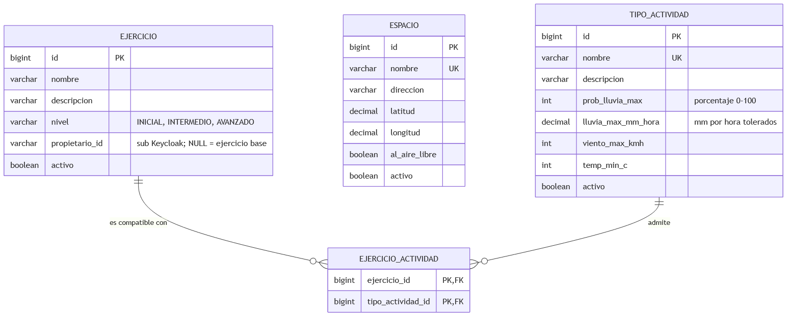

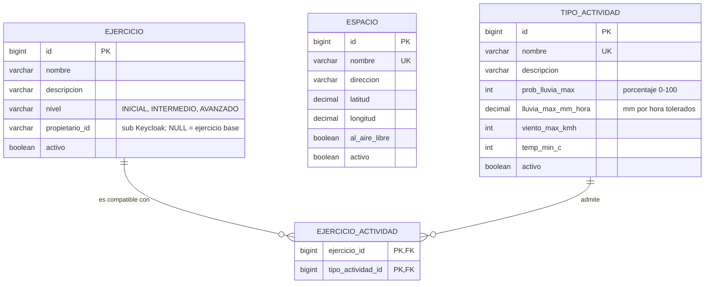

- TIPO_ACTIVIDAD guarda los criterios climáticos de cada actividad (probabilidad de lluvia a partir de la cual se considera que llueve, lluvia máxima tolerada en mm por hora, viento máximo y temperatura mínima).
- ESPACIO guarda las coordenadas que se usan para consultar el pronóstico.
- EJERCICIO tiene `propietario_id`: si es NULL es un ejercicio base, y si no, el ejercicio es personalizado de ese profesor (RN08).
- La relación entre ejercicios y actividades es N a N, a través de EJERCICIO_ACTIVIDAD (RN07).
- Las bajas son lógicas (`activo`).

### clases_db (ms-clases)

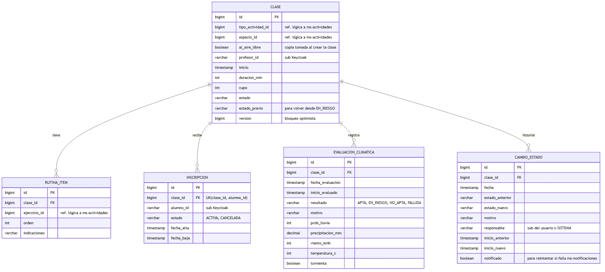

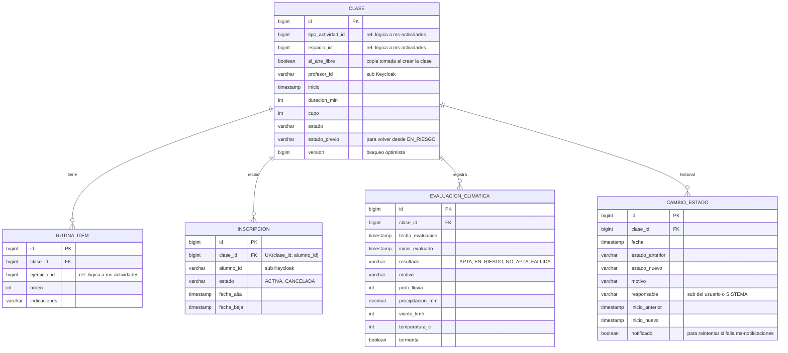

- CLASE guarda el estado y el `estado_previo`, que se usa para volver desde EN_RIESGO.
- `al_aire_libre` se copia del espacio al crear la clase. Así la tarea programada puede seleccionar las clases a evaluar sin consultar a ms-actividades por cada una.
- INSCRIPCION tiene una restricción única (clase, alumno). Al inscribir se bloquea la fila de la clase (`SELECT ... FOR UPDATE`) para que dos inscripciones simultáneas no superen el cupo (RN01).
- `version` en CLASE es un bloqueo optimista que evita que la tarea programada y el profesor cambien el estado de la clase al mismo tiempo.
- EVALUACION_CLIMATICA guarda cada resultado con los valores usados, incluidas las evaluaciones FALLIDAS.
- CAMBIO_ESTADO es el historial (F15). El campo `notificado` permite reenviar los avisos pendientes si ms-notificaciones no respondió (RN16). Su `id` forma parte del identificador de evento que garantiza la idempotencia (RN15).

### notificaciones_db (ms-notificaciones)

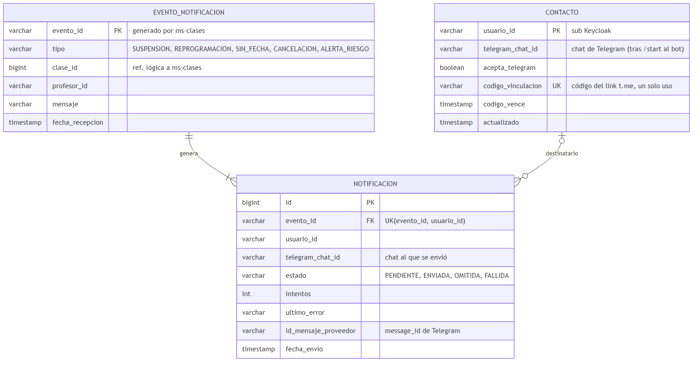

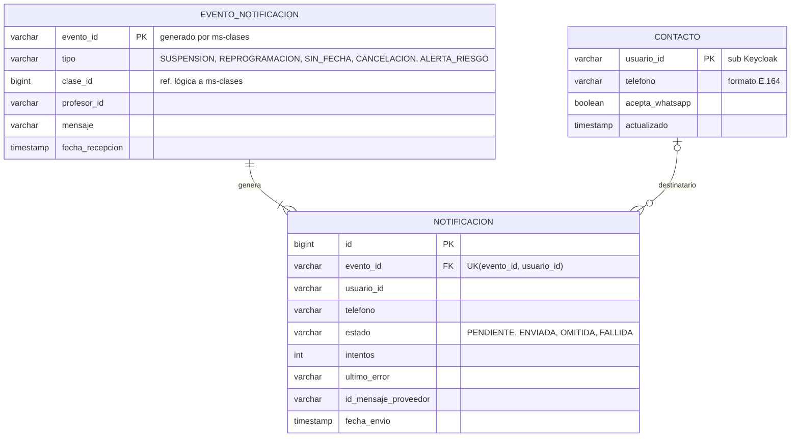

- CONTACTO guarda el teléfono y el consentimiento de cada usuario (RN14).
- EVENTO_NOTIFICACION registra cada evento recibido de ms-clases.
- NOTIFICACION tiene una fila por destinatario, con estado, intentos y último error. La restricción única (evento, usuario) implementa RN15.
- Un destinatario sin contacto registrado genera igual su notificación, que queda OMITIDA. Por eso la relación con CONTACTO es opcional.

### ms-clima y Keycloak

- **ms-clima** no tiene base de datos. Mantiene el pronóstico en una caché en memoria (Caffeine, 30 minutos por coordenada y día) y los escenarios simulados en memoria. La decisión es deliberada: el pronóstico se puede volver a consultar, y lo que tiene valor de negocio, la evaluación, se guarda en ms-clases junto a la clase.
- **Keycloak** usa su propia base `keycloak_db` en la misma instancia de PostgreSQL.

---

## Sección 09 — Arquitectura: Librería común

**Nombre:** `climafit-commons`. Coordenadas Maven: `ar.edu.utn.frc.climafit:climafit-commons:1.0.0`, empaquetado JAR.

**Propósito.** Concentrar el comportamiento técnico transversal que los microservicios necesitan de la misma forma, para que todos respondan los errores igual, interpreten los roles de Keycloak igual y se comuniquen entre sí con las mismas reglas de timeout, reintento y trazabilidad. Se implementa como autoconfiguración de Spring Boot (`AutoConfiguration.imports`, propiedades `climafit.*`), así que cada servicio la incorpora agregando la dependencia en su `pom.xml`.

**Componentes**
- **Errores (`...commons.error`):**
  - `ErrorResponse`: formato único con `status`, `codigo`, `mensaje`, `ruta`, `correlationId` y `fecha`.
  - Excepciones base: `NegocioException` (código y status HTTP), `RecursoNoEncontradoException`, `AccesoDenegadoException` y `ServicioNoDisponibleException`.
  - Manejador global (`@RestControllerAdvice`) que traduce estas excepciones, los errores de validación (400 `DATOS_INVALIDOS`) y los de seguridad (401/403) al formato común.
- **Seguridad (`...commons.seguridad`):**
  - `KeycloakRolesConverter`, que convierte `realm_access.roles` del JWT en autoridades de Spring Security.
  - Una configuración base de resource server: valida JWT, habilita `@PreAuthorize`, exige el rol SERVICIO en `/internal/**`, deja libre la documentación OpenAPI y exige autenticación en el resto.
  - `UsuarioActual`, que expone el `sub` y los roles del token para los controles de propiedad (RN05, RN08).
- **Trazabilidad (`...commons.trazabilidad`):** un filtro que lee o genera `X-Correlation-Id`, lo pone en el MDC de los logs y lo propaga en las llamadas salientes. Así se puede seguir un proceso distribuido en los logs de todos los servicios.
- **Cliente HTTP (`...commons.http`):** una fábrica de `RestClient` para llamadas entre servicios, configurable por propiedades, con:
  - timeout de conexión y de lectura;
  - reintentos solo en lecturas;
  - token de servicio obtenido por client credentials, con caché hasta que vence;
  - propagación del correlation id;
  - traducción de errores de conexión a `ServicioNoDisponibleException`.

**Servicios que la usan:** ms-actividades, ms-clases, ms-clima y ms-notificaciones (los cuatro microservicios funcionales). El API Gateway no la usa porque está construido sobre Spring WebFlux (reactivo) y la librería está pensada para servicios servlet. Su seguridad se configura en el propio gateway.

**Mecanismo de distribución.**
- Es un proyecto Maven independiente (`climafit-commons/`) que se instala en el repositorio local con `mvn clean install`.
- Los microservicios la declaran como dependencia en su `pom.xml`. El código no se copia entre proyectos.
- Para el despliegue, cada Dockerfile es multi-etapa: primero instala `climafit-commons` en el `.m2` de la imagen de build y después compila el microservicio. Así el despliegue con Docker Compose no depende de que la librería esté instalada en la máquina.

**Qué se comparte y qué no.**
- **Se comparte** lo que es igual en todos los servicios y no pertenece a ningún dominio: el formato de errores, la interpretación de roles, la trazabilidad y la política de comunicación entre servicios. Si cada servicio lo implementara por su cuenta, las respuestas y la seguridad quedarían inconsistentes.
- **Queda dentro de cada microservicio:**
  - Entidades, repositorios y DTOs de cada API. Compartirlos acoplaría los servicios: cada consumidor define su propio DTO con los campos que usa.
  - Reglas de negocio y máquina de estados (ms-clases).
  - Lógica de evaluación climática (ms-clima).
  - Clientes de Open-Meteo y Twilio (cada uno pertenece a un único servicio).
  - Reglas de autorización específicas de cada endpoint y los códigos de error propios de cada dominio (`CUPO_COMPLETO` vive en ms-clases; la librería solo aporta la clase base).

---

## Sección 10 — Implementación y verificación

### 10.1 Seguridad: autenticación, roles y verificación

**Mecanismo.**
- Keycloak es el Identity Provider, con el realm `climafit`. Los usuarios se autentican con OpenID Connect y reciben un JWT firmado (RS256) con sus roles de realm.
- La colección de Postman obtiene los tokens con el cliente público `climafit-api` (grant de contraseña, habilitado solo para pruebas).
- Para las llamadas entre servicios se usa el cliente confidencial `climafit-servicios`, con service account y el rol SERVICIO (grant client credentials).

**Roles y permisos.**
- **ADMIN:** gestiona actividades, criterios, espacios y ejercicios base. Puede cancelar cualquier clase, consultar historiales y notificaciones, ejecutar la evaluación general y usar los endpoints de simulación de clima.
- **PROFESOR:** crea y modifica sus clases y rutinas y sus ejercicios personalizados. Sobre sus propias clases puede reprogramar, cancelar, evaluar, decidir en riesgo y consultar historial, inscriptos y notificaciones. Puede consultar el pronóstico.
- **ALUMNO:** consulta clases y catálogo, se inscribe, cancela sus inscripciones y gestiona su contacto.
- **SERVICIO** (solo service account): accede a los endpoints `/internal/**` y a las lecturas del catálogo.

**Recursos protegidos y trusted zone.**
- Solo se publican al host el API Gateway (8080) y Keycloak (8090). Los microservicios y PostgreSQL quedan en la red interna de Docker.
- **Gateway (Security Filter, Spring Security WebFlux):**
  - Valida firma, vencimiento y emisor del JWT.
  - Rechaza las solicitudes sin token o con token inválido (401).
  - Aplica reglas gruesas por ruta y método (por ejemplo, `POST /api/actividades/**` solo ADMIN, `POST /api/clases` solo PROFESOR, `/api/clima/modo` y `/api/clima/escenarios` solo ADMIN) y responde 403.
  - No tiene rutas hacia `/internal/**`, así que una solicitud a esas rutas desde afuera devuelve 404.
- **Microservicios (resource servers, vía `climafit-commons`):**
  - Vuelven a validar el JWT, como defensa en profundidad: la red interna no se considera confiable por sí sola.
  - Aplican `@PreAuthorize` por endpoint.
  - Hacen los controles de propiedad, que el gateway no puede resolver: profesor dueño de la clase (RN05), dueño del ejercicio (RN08) y dueño de la inscripción.
  - Exigen el rol SERVICIO en `/internal/**`.
- **Emisor del token:** Keycloak se configura con `KC_HOSTNAME=http://localhost:8090`, para que el emisor del token sea el mismo cuando el token se obtiene desde Postman y cuando los servicios lo validan dentro de Docker. Los servicios descargan las claves desde `http://keycloak:8080/.../certs`.

**Comportamiento ante accesos no autorizados.**
- Sin token o con token inválido o vencido: **401** con `WWW-Authenticate: Bearer` y cuerpo `{"codigo": "NO_AUTENTICADO"}`.
- Con token pero sin el rol o sin ser dueño del recurso: **403** `{"codigo": "ACCESO_DENEGADO"}`.
- Ejercicio personalizado de otro profesor: **404**, para no revelar que existe.
- Ruta interna desde afuera: **404** (no está enrutada en el gateway).

**Cómo comprobarlo** (carpetas 01, 04, 07 y 09 de la colección):
- **Permitido:** el profesor 1 hace `POST /api/clases` con su token y recibe **201**. El alumno 1 hace `POST /api/clases/{id}/inscripciones` y recibe **201**.
- **Rechazado sin autenticación:** `GET /api/actividades` sin token devuelve **401**.
- **Rechazado por rol:** el alumno 1 hace `POST /api/clases` o `POST /api/actividades` y recibe **403**.
- **Rechazado por propiedad:** el profesor 2 hace `PATCH /api/clases/{claseDeProfe1}/decision-riesgo` y recibe **403**.
- **Rechazado por trusted zone:** `POST /api/internal/notificaciones` devuelve **404**.

### 10.2 Tecnologías, configuración y arranque

**Tecnologías y versiones principales** (las versiones finales se ajustan a las usadas en la cátedra):
- **Base:** Java 21 (Eclipse Temurin), Maven 3.9.
- **Spring:** Spring Boot 3.5.x, Spring Cloud 2025.0.x (Spring Cloud Gateway), Spring Security con OAuth2 Resource Server y OAuth2 Client, Spring Data JPA.
- **Bibliotecas:** springdoc-openapi 2.8.x, Flyway, Caffeine, Bean Validation.
- **Infraestructura:** PostgreSQL 17, Keycloak 26.x, Docker y Docker Compose v2.
- **Servicios externos:** Open-Meteo Forecast API (sin API key) y Twilio Programmable Messaging para WhatsApp (sandbox), ambos consumidos con `RestClient`, sin SDK.

**Dependencias de infraestructura:** PostgreSQL (bases de cada servicio y de Keycloak) y Keycloak (realm importado al arrancar). Para el modo REAL se necesita acceso a Internet hacia Open-Meteo, y opcionalmente hacia Twilio.

**Configuración por entorno.**
- Cada servicio tiene `application.yml` con valores por defecto y los perfiles `local` (ejecución desde el IDE contra los contenedores de infraestructura), `docker` (dentro de Compose) y `demo` (habilita los modos y escenarios de ms-clima y usa el proveedor `log` de WhatsApp).
- Los secretos y valores que cambian según el entorno se pasan por variables definidas en `.env`, a partir de `.env.example`, que se versiona sin valores reales:
  - `POSTGRES_PASSWORD`;
  - contraseñas de cada base;
  - `KEYCLOAK_ADMIN` y `KEYCLOAK_ADMIN_PASSWORD`;
  - `CLIENTE_SERVICIOS_SECRET`;
  - `SPRING_PROFILES_ACTIVE` (`docker,demo`);
  - `WHATSAPP_PROVEEDOR` (`log` o `twilio`);
  - `TWILIO_ACCOUNT_SID`, `TWILIO_AUTH_TOKEN` y `TWILIO_FROM`;
  - `TZ=America/Argentina/Cordoba`.
- Ningún secreto queda en el código.

**Archivos que permiten ejecutar la solución.**
- `docker-compose.yml`: define `postgres`, `keycloak`, `ms-actividades`, `ms-clases`, `ms-clima`, `ms-notificaciones` y `api-gateway`, con healthchecks y `depends_on: condition: service_healthy` para respetar el orden de arranque.
- `.env.example`: plantilla de variables.
- `infra/postgres/init.sql`: crea las bases y los usuarios.
- `infra/keycloak/climafit-realm.json`: realm con roles, clientes y usuarios de prueba (`admin1`, `profe1`, `profe2`, `alumno1`, `alumno2`, `alumno3`).
- Un `Dockerfile` multi-etapa por componente.
- Migraciones Flyway en cada servicio con datos iniciales:
  - actividades Yoga, Funcional, Running, Acrobacia aérea y Patinaje con sus criterios;
  - espacios Parque Sarmiento, Parque de las Tejas y un gimnasio techado;
  - ejercicios base.
- `postman/`: colección y entorno.

**Procedimiento de arranque.**
1. Clonar el repositorio y copiar `.env.example` a `.env` (los valores por defecto sirven para la demo).
2. Ejecutar `docker compose up -d --build`. La primera vez compila la librería y los servicios dentro de las imágenes.
3. Esperar a que `docker compose ps` muestre todos los servicios como `healthy` (aproximadamente 1 a 2 minutos, por Keycloak).
4. Verificar el acceso:
   - Swagger UI en `http://localhost:8080/swagger-ui.html`;
   - consola de Keycloak en `http://localhost:8090`.
5. Importar en Postman la colección y el entorno de `postman/` y ejecutar la colección completa con el Collection Runner.

Para desarrollo local sin contenedores para los servicios:
1. `mvn -f climafit-commons/pom.xml clean install`.
2. `docker compose up -d postgres keycloak`.
3. Ejecutar cada servicio con el perfil `local`.

### 10.3 Colección ejecutable de llamadas (Postman)

Se entregan `postman/ClimaFit.postman_collection.json` y `postman/ClimaFit-local.postman_environment.json`. Todas las solicitudes pasan por el API Gateway. Está pensada para ejecutarse completa y en orden con el Collection Runner sobre una solución recién levantada con el perfil `demo`.

**Organización por flujo (carpetas):**
- **00 Preparación:** tokens de los 6 usuarios de prueba, cálculo de fechas relativas a la hora actual (en hora de Córdoba) y puesta de ms-clima en modo SIMULADO sin escenarios.
- **01 Seguridad:** 401 sin token y con token inválido, 403 por rol, 404 en ruta interna y una solicitud permitida.
- **02 Catálogo:** alta de actividad, validación 400, espacios, ejercicio personalizado, 404 al consultar un ejercicio ajeno y baja lógica.
- **03 Contactos:** consentimiento de cada usuario (el alumno 2 no acepta WhatsApp) y teléfono inválido (400).
- **04 Clases e inscripciones:**
  - creación de las clases A, B y C (profesor 1, al aire libre) y E (profesor 2, techada);
  - ejercicio incompatible (422), superposición del profesor (409) y alumno que intenta crear una clase (403);
  - inscripciones, cupo completo (409), superposición del alumno (409) y cancelación de inscripción.
- **05 Proceso: falla del clima:** modo FALLA → evaluación FALLIDA → la clase sigue PROGRAMADA.
- **06 Proceso: NO_APTA y reprogramación:** escenario de lluvia → clase A REPROGRAMADA al día siguiente a la misma hora → inscripciones activas → historial → notificaciones ENVIADA y OMITIDA, sin duplicados.
- **07 Proceso: EN_RIESGO:** viento cerca del límite → EN_RIESGO y alerta al profesor → el profesor 2 intenta decidir (403) → el profesor 1 suspende → REPROGRAMADA.
- **08 Proceso: sin día viable:** lluvia durante 8 días → SUSPENDIDA_SIN_FECHA → el profesor reagenda → REPROGRAMADA, con sus avisos.
- **09 Otras reglas:** clase techada no evaluable (409), decisión sobre una clase que no está en riesgo (409), cancelación ajena (403), cancelación propia y inscripción a una clase cancelada (409), evaluación general.
- **10 Integración real:** modo REAL y consulta del pronóstico real de Open-Meteo, luego vuelta al modo SIMULADO.

**Variables de entorno:**
- `baseUrl` (`http://localhost:8080/api`), `keycloakUrl`, `realm` y `clientId`.
- Usuarios y contraseñas de prueba.
- `telefonoPrueba`.
- Ids y coordenadas de los datos iniciales.

Los tokens, los ids de las clases creadas y las fechas se guardan automáticamente como variables de la colección con scripts de test.

**Autenticación:** cada solicitud usa Bearer Token con la variable del usuario que corresponde (`{{tokenProfe1}}`, `{{tokenAlumno1}}`, etc.), obtenida en la carpeta 00.

**Datos iniciales:** los aporta el arranque (realm de Keycloak y migraciones Flyway). La colección crea su propio escenario y calcula las fechas en relación con la hora actual, así que se puede ejecutar en cualquier momento.

**Orden de ejecución:** de la carpeta 00 a la 10, sin saltear carpetas, porque cada una usa variables de las anteriores. Para repetir la ejecución, conviene reiniciar con `docker compose down -v && docker compose up -d`.

**Verificaciones:** cada solicitud valida el código HTTP y, cuando corresponde, el `codigo` de error, el estado de la clase, el resultado de la evaluación, la nueva fecha y el estado de las notificaciones. En total son 74 solicitudes.

**Escenarios que cubre:**
- **Positivos:** proceso central completo (F11, F13, F14, F15), decisión del profesor (F12), reagenda manual (F06), inscripción y cancelación (F09), catálogo (F02 a F04), contactos (F10) e integración real con Open-Meteo.
- **Negativos:**
  - seguridad: 401, 403 y 404 interno;
  - reglas: RN01, RN02, RN03, RN04, RN05, RN07, RN08, RN09 y RN12;
  - validaciones (400);
  - falla del servicio externo (RN16).
- **Lo que no cubre la colección:** RN15 (idempotencia) se verifica comprobando que no haya notificaciones duplicadas, pero el envío repetido de un mismo evento se prueba con un test de integración en ms-notificaciones, porque el endpoint interno no está expuesto (por diseño).

---

## Sección 11 — Compromiso del equipo

### 11.1 Compromiso

**Proceso central que quedará funcionando:** la evaluación climática y reprogramación de clases al aire libre, de principio a fin:
1. Selección de las clases de las próximas 24 horas.
2. Consulta del pronóstico real (Open-Meteo) o simulado.
3. Evaluación contra los criterios de la actividad.
4. Mantener la clase, ponerla en riesgo con decisión del profesor o suspenderla.
5. Búsqueda automática de un nuevo día.
6. Traslado de las inscripciones.
7. Aviso por WhatsApp a cada inscripto.
8. Registro en el historial.

El proceso se ejecuta de forma programada y también a pedido.

**Funcionalidades obligatorias:**
- **Prioridad alta:** F01, F02, F03, F05, F06, F07, F08, F09, F10, F11, F12, F13 y F14.
- **Prioridad media:** F04 (ejercicios) y F15 (historial).
- **Reglas:** RN01 a RN16.

**Requisitos del enunciado cubiertos:**
- API Gateway con Security Filter.
- 4 microservicios funcionales en Spring Boot con colaboración real en el proceso central.
- Keycloak con OIDC, JWT y roles.
- Integración con una API pública externa (Open-Meteo) que interviene en la decisión de negocio.
- Librería propia `climafit-commons`, instalada en `.m2` y usada por 4 microservicios.
- PostgreSQL.
- APIs REST documentadas con OpenAPI.
- Despliegue completo con Docker Compose.

**Integraciones relevantes:**
- **Open-Meteo:** define la decisión de suspender.
- **Twilio WhatsApp:** canal de aviso, con proveedor `log` para la demo.
- **Keycloak:** usuarios y tokens de servicio.
- **Colaboración entre servicios:** ms-clases con ms-actividades, ms-clima y ms-notificaciones.

**Desafíos técnicos y funcionales:**
- La búsqueda de un nuevo día con varias restricciones a la vez: el profesor libre y el pronóstico apto, que depende de otro servicio.
- La consistencia de un proceso distribuido: que la suspensión no quede a medias, que el aviso se reenvíe si falla y que no haya mensajes duplicados.
- El tratamiento de las fallas de servicios internos y externos sin perder el estado de la clase.
- La seguridad en dos niveles: el gateway y los microservicios, con controles de propiedad y token de servicio para la trusted zone.
- Que el proceso se pueda demostrar de forma reproducible sin depender del clima real del día de la defensa, mediante el modo simulado.

**Exclusiones expresas:**
- Interfaz de usuario.
- Pagos.
- Asistencia.
- Lista de espera.
- Confirmación de asistencia a clases reprogramadas.
- Respuestas por WhatsApp.
- Otros canales de notificación.
- Reserva o capacidad de espacios.
- Multi-tenant.
- Broker de mensajería.

**Riesgos y dependencias:**
- **Sandbox de Twilio:** cada número destinatario tiene que unirse previamente y hay límites de sesión. Mitigación: el proveedor `log` permite demostrar el proceso completo; el envío real se muestra con el teléfono de un integrante.
- **Disponibilidad de Open-Meteo y clima real del día de la defensa:** mitigación con caché, el tratamiento de RN16 y el modo SIMULADO para los escenarios.
- **Configuración de Keycloak en Docker** (emisor del token, importación del realm): se resuelve con `KC_HOSTNAME` fijo y el realm versionado en el repositorio.
- **Zonas horarias:** se usa `America/Argentina/Cordoba` en la JVM, en la base y en la consulta a Open-Meteo.
- **Tiempo del equipo hacia el cierre del año:** se implementan primero las funcionalidades de prioridad alta y el proceso central. F04 y F15 quedan para después.

### 11.2 Comprobaciones observables

**CP1 — Seguridad y roles**
- Condición inicial: solución levantada y tokens obtenidos (carpeta 00).
- Acción:
  1. `GET /api/actividades` sin token.
  2. `POST /api/clases` con el token del alumno 1.
  3. `POST /api/clases` con el token del profesor 1.
  4. `PATCH /api/clases/{B}/decision-riesgo` con el token del profesor 2.
- Resultado esperado: 401, 403, 201 y 403, respectivamente.
- Relación: F01, F05, RN05; carpetas 01, 04 y 07.

**CP2 — Inscripción con cupo y superposición**
- Condición inicial: la clase A (cupo 2) tiene inscriptos al alumno 1 y al alumno 2, y la clase E es a la misma hora que A.
- Acción:
  1. El alumno 3 hace `POST /api/clases/{A}/inscripciones`.
  2. El alumno 1 hace `POST /api/clases/{E}/inscripciones`.
- Resultado esperado: 409 `CUPO_COMPLETO` y 409 `SUPERPOSICION_ALUMNO`.
- Relación: F09, RN01, RN03.

**CP3 — Proceso central: suspensión y reprogramación automática**
- Condición inicial: la clase A de Yoga está PROGRAMADA dentro de las próximas 24 h, con el alumno 1 (acepta WhatsApp) y el alumno 2 (no acepta), y hay un escenario de 90 % de lluvia con 5 mm/h en el horario de la clase (Yoga tolera 0,5 mm/h).
- Acción:
  1. `POST /api/clases/{A}/evaluaciones`.
  2. Consultar la clase, sus inscripciones, `GET /api/clases/{A}/historial` y `GET /api/notificaciones?claseId={A}`.
- Resultado esperado:
  - la evaluación da NO_APTA;
  - la clase queda REPROGRAMADA al día siguiente a la misma hora;
  - las 2 inscripciones siguen activas;
  - el historial muestra PROGRAMADA → SUSPENDIDA → REPROGRAMADA;
  - hay una notificación ENVIADA para el alumno 1 y una OMITIDA para el alumno 2, sin duplicados.
- Relación: F11, F13, F14, F15, RN09, RN10, RN11, RN13, RN14, RN15.

**CP4 — Clase en riesgo y decisión del profesor**
- Condición inicial: la clase B de Yoga tiene un escenario de viento de 30 km/h; el límite de la actividad es 35 km/h.
- Acción:
  1. `POST /api/clases/{B}/evaluaciones`.
  2. El profesor 1 hace `PATCH /api/clases/{B}/decision-riesgo` con `SUSPENDER`.
- Resultado esperado:
  - el primer paso da EN_RIESGO, la clase queda EN_RIESGO y se registra una notificación ALERTA_RIESGO para el profesor;
  - el segundo deja la clase REPROGRAMADA y genera un aviso al alumno inscripto.
- Relación: F12, F14, RN10, RN11, RN12.

**CP5 — Sin día viable y reagenda manual**
- Condición inicial: la clase C de Running tiene un escenario de 95 % de lluvia con 8 mm/h en Parque de las Tejas durante 8 días (Running tolera 4 mm/h).
- Acción:
  1. `POST /api/clases/{C}/evaluaciones`.
  2. `PATCH /api/clases/{C}/reprogramacion` con una nueva fecha.
- Resultado esperado: el primer paso deja la clase SUSPENDIDA_SIN_FECHA con aviso de tipo SIN_FECHA; el segundo la deja REPROGRAMADA con aviso de tipo REPROGRAMACION.
- Relación: F06, F13, RN13.

**CP6 — Falla del servicio de clima**
- Condición inicial: ms-clima está en modo FALLA (`PUT /api/clima/modo`).
- Acción: `POST /api/clases/{A}/evaluaciones`.
- Resultado esperado: la evaluación queda registrada como FALLIDA y la clase sigue PROGRAMADA, sin notificaciones.
- Relación: F11, RN16.

**CP7 — Despliegue e integración real**
- Condición inicial: un entorno limpio con Docker.
- Acción:
  1. `docker compose up -d --build`.
  2. Con el modo REAL, `GET /api/clima/pronostico` para las coordenadas del Parque Sarmiento.
- Resultado esperado: todos los contenedores quedan healthy sin pasos manuales, el Swagger UI unificado responde y se obtiene el pronóstico horario real de Open-Meteo.
- Relación: requisitos de despliegue e integración externa; carpeta 10.
